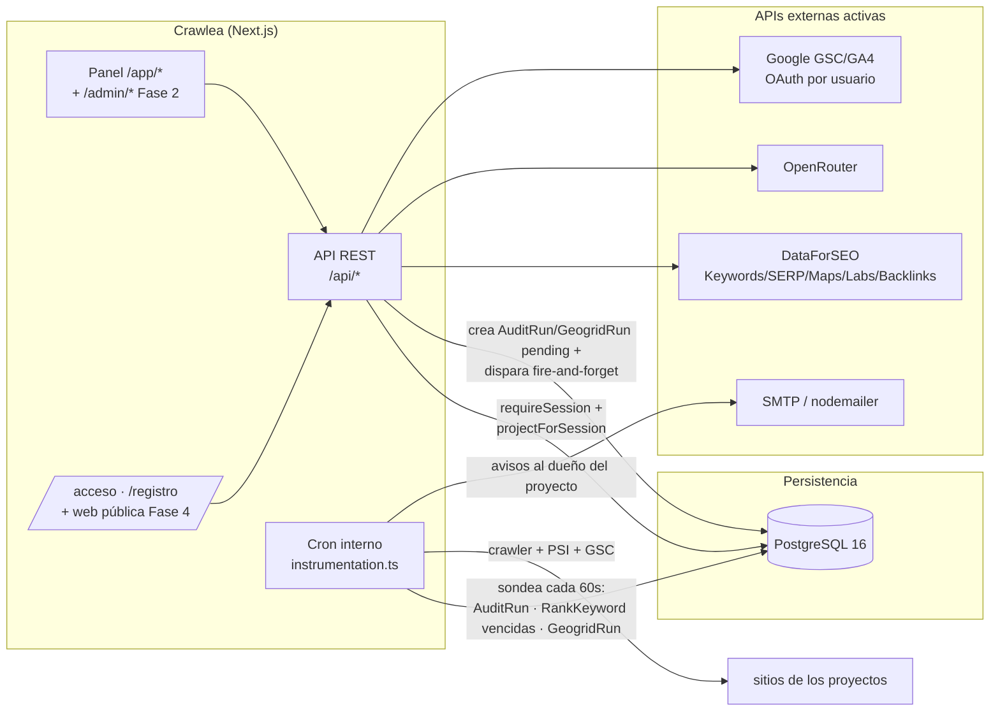

# 02 — Arquitectura

## Visión de alto nivel

Crawlea es una aplicación **monolítica Next.js 16** (App Router) que contiene el
panel de la herramienta (`/app`), la API REST (`/api`), el futuro panel de
administración de la plataforma (`/admin`, Fase 2) y la futura web pública (`/`,
Fase 4). Toda la persistencia vive en una única base **PostgreSQL**. Es
**multi-usuario (SaaS)**: cada `User` es dueño de sus `Project` y el aislamiento
vive en `src/lib/auth-guards.ts` (`requireSession` + `projectForSession`) — el
admin de la plataforma ve todos los proyectos. Ver [`06-roadmap-saas.md`](./06-roadmap-saas.md)
para el estado de la transición desde el single-tenant original.



## Estructura de carpetas

```
src/
├── middleware.ts          # páginas: /app exige sesión, /admin exige role admin
├── instrumentation.ts     # único fichero que Next.js auto-descubre para el hook
├── instrumentation-node.ts # lógica real del cron (Módulo 8), solo runtime Node
├── app/
│   ├── acceso/ · registro/        # login/registro públicos (Google + credentials admin)
│   ├── app/                        # LA HERRAMIENTA (requiere sesión, ver layout.tsx)
│   │   ├── layout.tsx              # requireSession + Providers + AdminShell
│   │   ├── page.tsx                # dashboard general (acotado a los proyectos del usuario)
│   │   ├── costes/                 # consumo de API (del usuario; global para el admin)
│   │   ├── perfil/                 # cuenta: plan, consumo, Google propio, borrado
│   │   ├── configuracion/          # claves de API y config global (plataforma)
│   │   └── proyectos/              # Módulo 2 + resto de módulos anidados por [id]
│   │       └── [id]/
│   │           ├── layout.tsx      # CHOKE POINT: projectForSession → 404 si no es tuyo
│   │           ├── perfil, tareas, notas, titulos-meta, schema, rank,
│   │           │   google, competidores, backlinks, geogrid, informe
│   │           ├── keywords/       # + keywords/arquitectura (pestaña por ruta)
│   │           ├── contenido/      # + contenido/tfidf (pestaña por ruta)
│   │           └── auditoria/      # + auditoria/enlaces y
│   │                           #   auditoria/canibalizaciones (pestañas)
│   │           (el nav de módulos vive en el sidebar global; las
│   │            sub-herramientas fusionadas son pestañas por ruta —
│   │            ver "Navegación" abajo)
│   ├── admin/                      # panel de administración (Fase 2): resumen, usuarios, costes
│   ├── (marketing)/               # web pública (Fase 4): home, precios, contacto, legales
│   └── api/
│       ├── auth/[...nextauth]/
│       ├── perfil/                 # DELETE cuenta (cascada)
│       ├── proyectos/              # GET filtra por userId; POST asigna dueño + límite plan
│       ├── configuracion/ · dataforseo/ · tareas-plantillas/  # gates de admin
│       ├── google/oauth/           # conexión GSC/GA4 POR USUARIO
│       └── costes/                 # agregado del usuario o global (admin)
├── components/
│   ├── auth/               # AuthPanel (login/registro compartido)
│   └── app/                # AdminShell, AdminSidebar, AdminHeader, ProjectSwitcher...
└── lib/
    ├── db/prisma.ts        # cliente Prisma (adapter PrismaPg)
    ├── auth.ts              # NextAuthOptions: Google OAuth + credentials (admin)
    ├── auth-guards.ts       # AISLAMIENTO: requireSession + projectForSession + isAdmin
    ├── plans.ts             # planes del SaaS: topeUsdMes, maxProyectos, módulos por plan
    ├── crypto.ts            # AES-256-CBC, secretos (refresh tokens, AppSetting)
    ├── rate-limit.ts        # limitador de intentos de login
    ├── utils.ts
    ├── seo/                 # Módulos 3/4/7: scraping, cliente OpenRouter, log de coste
    ├── google/               # Módulo 6: OAuth2 por usuario, Search Console, GA4
    ├── keywords/             # Módulo 1: cliente DataForSEO Labs, caché, orquestación, estructura
    ├── rank/                 # Módulo 5: cliente SERP DataForSEO, chequeo, job programado
    ├── geogrid/              # Módulo 9: rejilla de coordenadas, cliente Maps SERP, job
    ├── dataforseo/           # cliente HTTP Basic + tope de gasto (spend.ts, 3 niveles:
    │                         # global → plan del usuario → proyecto), compartido por
    │                         # Módulos 1, 5, 9, TF-IDF, Competidores y Backlinks
    ├── audit/                # Módulo 8: robots.txt, sitemap, crawler, PSI, scoring, cron,
    │                         # generación automática de tareas desde hallazgos
    ├── tfidf/                 # TF-IDF: SERP (vía SerpCache) + scraping + cálculo de términos
    ├── links/                 # PageRank interno sobre AuditRun.linkGraph, huérfanas, hubs
    ├── copilot/                # contexto de proyecto + chat vía OpenRouter (solo lectura)
    ├── competitors/            # DataForSEO Labs: visibilidad de dominio + content gap
    └── notifications/          # avisos por email al dueño (nodemailer), dedupe por (userId, type, key)
```

## Navegación

El panel abandonó las pestañas horizontales por proyecto (el antiguo
`ProjectSubNav.tsx` ya no existe en el repo) a favor de un único sidebar global
(`AdminSidebar.tsx`):

- **Nivel global**, siempre visible: Panel general (`/app`), Proyectos
  (`/app/proyectos`), Costes (`/app/costes`), Mi perfil (`/app/perfil`),
  Configuración (`/app/configuracion`).
- **Nivel de proyecto**: cuando la ruta cae bajo `/app/proyectos/[id]/...`, aparece
  un segundo bloque bajo un divisor: `ProjectSwitcher.tsx` (combobox con buscador +
  sección "Recientes", últimos 5 vía `localStorage["crawlea:recentProjects"]`) seguido
  de la lista vertical fija de módulos que devuelve `projectNav()` — Perfil, Tareas,
  Notas; grupos Investigación (Keywords), On-Page (Título y Meta, Schema, Contenido),
  Técnico (Auditoría), Seguimiento (Rank Tracking, Google, Competidores, Backlinks,
  Geogrid solo si `isLocalBusiness`); e Informe. Las sub-herramientas se fusionaron
  como **pestañas por ruta** (`ModuleTabs.tsx` montado en el `layout.tsx` de cada
  módulo contenedor): Arquitectura dentro de Keywords, TF-IDF dentro de Contenido,
  Enlaces y Canibalizaciones dentro de Auditoría — URL real en cada pestaña para que
  los deep-links (`?estudio=`, `?keyword=`) y los bookmarks sigan funcionando. Las
  rutas antiguas (`/arquitectura`, `/tfidf`, `/enlaces`, `/canibalizaciones`)
  redirigen desde `next.config.ts` (`redirects()`), y `switchProject` del sidebar
  traduce los segmentos legacy (`LEGACY_MODULE_SEGMENTS`) al cambiar de proyecto.
  Cambiar de proyecto desde el switcher preserva el módulo activo cuando existe
  en el proyecto destino (y descarta "geogrid" si el destino no es negocio local).
- El listado de proyectos se pide client-side desde `/api/proyectos` (el sidebar vive en
  el shell de toda la app, no en un layout anidado bajo `[id]`).
- El panel usa ancho completo (`ca28b5f`, `ba7e839`) — solo los formularios "puros"
  (alta/edición de proyecto, configuración) mantienen `max-w-4xl`.

## Decisiones de esta fase

- **Caché de DataForSEO (Módulo 1):** `KeywordDataCache`, clave por (keyword, idioma,
  ubicación), 30 días de frescura, compartida entre proyectos (el volumen es un dato
  objetivo de SERP). El coste de cada llamada real se registra en `ApiUsageLog`
  (`api: "dataforseo"`, dos filas por estudio nuevo: volumen + intención). Un estudio
  100% servido desde caché no genera ninguna fila nueva de coste — la prueba de que el
  caché funciona.
- **Trabajo en segundo plano sin BullMQ/Redis (decisión del Módulo 8):** el spec
  original asume BullMQ+Redis para el crawler, pero se optó por un cron interno vía
  el hook de instrumentación de Next.js, sondeando una tabla de Postgres cada 60s. Motivo:
  las auditorías son manuales o como mucho mensuales, no tiempo real; evitar Redis
  significa un servicio menos que desplegar y monitorizar en el VPS. Los
  Módulos 5 (Rank Tracking) y 9 (Geogrid) **ya reutilizan** este mismo poller
  (`instrumentation-node.ts` ejecuta `runAuditJob`, `runRankJob` y `runGeogridJob` en
  secuencia cada tick) — no se montó Redis. Las rutas POST de auditoría y geogrid
  además disparan el procesamiento por import dinámico fire-and-forget nada más crear
  el run, para no depender de esperar al siguiente tick en dev/producción.
  - **Gotcha real encontrado al construirlo:** Next.js solo auto-descubre un fichero
    llamado exactamente `instrumentation.ts` en la raíz de `src/` — el sufijo `-node`
    (`src/instrumentation-node.ts`) **no** es una convención que Next reconozca por
    sí sola, es solo el nombre de un módulo pensado para ser importado desde el
    `instrumentation.ts` real. Crawlea tiene el fichero correcto
    (`src/instrumentation.ts` importa condicionalmente `./instrumentation-node` solo
    cuando `process.env.NEXT_RUNTIME === "nodejs"`); sin ese fichero puente, el cron
    nunca se ejecutaría.
- **Tope de gasto (`src/lib/dataforseo/spend.ts`):** `assertWithinSpendLimit(projectId?)`
  se llama antes de cualquier llamada de pago a DataForSEO (rank, geogrid, keyword
  suggestions, TF-IDF, competidores). Tres niveles en orden: tope global
  (`DATAFORSEO_MONTHLY_LIMIT_USD`), tope del plan del dueño (`src/lib/plans.ts`,
  el admin no está limitado) y, si está definido, `Project.spendLimitUsd`.
  Superar cualquiera → lanza y bloquea la llamada. Complementa la estimación
  pre-confirmación (precios verificados en `src/lib/dataforseo/pricing.ts`) que ya
  se muestra en la UI antes de gastar.
- **`SerpCache` (caché cruzada entre módulos):** el top-10 orgánico de cada chequeo de
  Rank Tracking se guarda 7 días; TF-IDF lo reutiliza para no pagar una segunda llamada
  SERP por la misma keyword — relación productor/consumidor de un solo sentido (rank
  produce, TF-IDF consume), no al revés.
- **`lib/crypto.ts`**: primer consumidor real en el Módulo 6 (refresh token de Google
  cifrado en BD).
- **`runAuditJob` fuera de la cadena secuencial del cron:** el crawler de Auditoría
  pasó de rastrear una muestra (50 páginas) a rastrear el sitio entero (techo de
  seguridad 5000 páginas) — un crawl real puede tardar 30-60+ min. Si
  `instrumentation-node.ts` lo esperara dentro de su cadena `await` secuencial,
  bloquearía `runRankJob`/`runGeogridJob`/`runBootstrapJob` de TODOS los proyectos
  durante ese tiempo. Se lanza fire-and-forget con un guard en memoria
  (`auditJobInFlight`) que evita solaparlo consigo mismo si un tick de 60s llega
  mientras el anterior sigue en marcha. El disparo manual ("Ejecutar auditoría
  ahora") ya era fire-and-forget desde su propia ruta POST; esta excepción cubre el
  mismo caso para las auditorías mensuales programadas, que dependen del cron para
  procesarse.

## Decisiones del SaaS (Fase 1, commit `49e26fb`)

- **Aislamiento por where compuesto, no por capa ORM.** `projectForSession()` filtra
  el `findUnique` con `{ id, userId }` (el admin sin el filtro): sin race conditions
  ni "load-then-check". Las rutas de recursos hijos no re-verifican el hijo contra
  el usuario, verifican el PROYECTO PADRE — el hijo solo es alcanzable si el padre
  pasa el gate.
- **Suspensión efectiva al instante:** el JWT no se invalida, pero `requireSession()`
  relee `User.status` de BD en cada petición. Coste: un SELECT por PK y petición;
  beneficio: suspender desde el panel (Fase 2) corta el acceso sin esperar expiración.
- **Creación de cuenta en el callback `signIn`** (no en `jwt`): es el único punto que
  puede rechazar un suspendido ANTES de emitir token.
- **Cron hereda el tenant gratis:** los jobs procesan runs pendientes globales que
  ya cuelgan de un `Project` con dueño; el guard de gasto del plan aplica dentro de
  cada job sin cambios de query.
- **Caches compartidas entre usuarios a propósito:** `KeywordDataCache`/`SerpCache`
  son globales (el dato de SERP no depende de quién pregunta) — amortiguan el coste
  de DataForSEO entre cuentas.
- **Free sin límites de módulos de momento:** sin vía de pago no se bloquea a nadie;
  el listado `modulos` del plan y su enforcement llegan con Stripe (Fase 3). Las
  cifras de planes son placeholder en `src/lib/plans.ts`.
